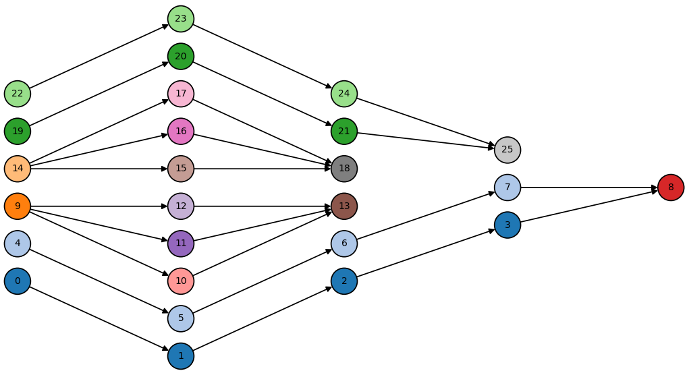
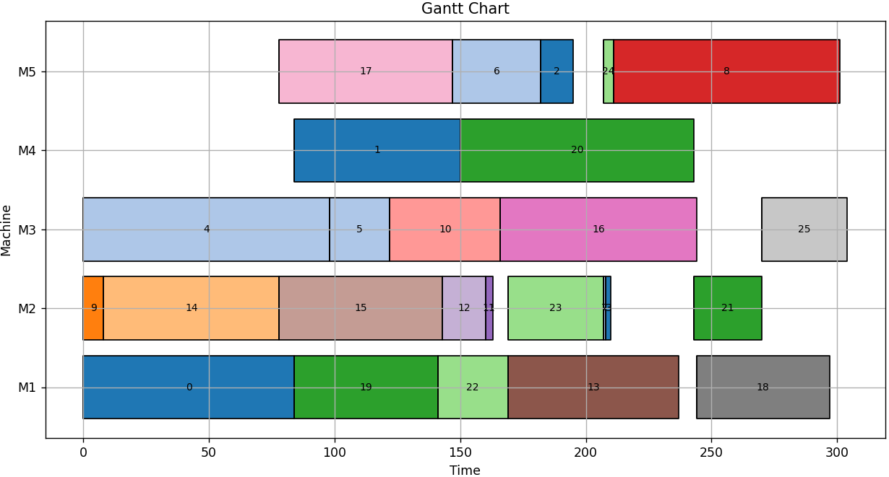

[](https://github.com/ai-for-decision-making-tue/Job_Shop_Scheduling_Benchmark_Environments_and_Instances/blob/main/LICENSE)

## Job Shop Scheduling Benchmark: Environments and Instances for Learning and Non-learning Methods

### 📖 Overview:
This repository provides a comprehensive benchmarking environment for a variety of machine scheduling problems, including Job Shop Scheduling (JSP), Flow Shop Scheduling (FSP), Flexible Job Shop Scheduling (FJSP), FJSP with Assembly constraints (FAJSP), FJSP with Sequence-Dependent Setup Times (FJSP-SDST), and the online FJSP (with online job arrivals). It aims to be a centralized hub for researchers, practitioners, and enthusiasts interested in tackling machine scheduling challenges.

### 🛠 Solution Methods:
The repository includes exact, heuristic and learning based solution methods, each compatible with one or more machine scheduline problem variants:

| Solution methods | Type | JSP | FSP | FJSP | SDST | AJSP | Dynamic JSP |
| :----: | :---:| :---:| :---: | :---: | :---: | :---: | :---: |
| MILP | Exact | ✓ | ✓ | ✓ | ✓ | ✓ | ✗ | 
| CP-SAT | Exact | ✓ | ✓ | ✓ | ✓ | ✓ | ✗ |
| Dispatching Rules | Heuristic | ✓ | ✓ | ✓ | ✓ | ✓ | ✓ |
| Genetic Algorithm | Heuristic |✓ | ✓ | ✓ | ✓ | ✓ | ✗ |
| L2D | DRL |✓ | ✓ | ✗ | ✗ | ✗ | |
| FJSP-DRL | DRL | ✓ | ✓ | ✓ | ✗ | ✗ | ✓ |
| DANIEL | DRL | ✓ | ✓ | ✓ | ✗ | ✗ | |  

### 🚀 How to use:

Here we provide some short examples on how to use the solution methods in this repository. For more detailed information and more examples, please refer to the tutorials [here][2] and [here][3].

1. **Dispatching Rules:**

  ```python

from solution_methods.L2D import run_dispatching_rules
from solution_methods.helper_functions import load_job_shop_env, load_parameters

parameters = load_parameters("configs/dispatching_rules.toml")
jobShopEnv = load_job_shop_env(parameters['instance'].get('problem_instance'))

makespan, jobShopEnv = run_dispatching_rules(jobShopEnv, **parameters)
  ```

2. **Genetic Algorithm:**  
  ```python
  from solution_methods.helper_functions import load_job_shop_env, load_parameters
  from solution_methods.GA.run_GA import run_GA
  from solution_methods.GA.src.initialization import initialize_run
  
  parameters = load_parameters("configs/genetic_algorithm.toml")
  jobShopEnv = load_job_shop_env(parameters['instance'].get('problem_instance'))

  population, toolbox, stats, hof = initialize_run(jobShopEnv, **parameters)
  makespan, jobShopEnv = run_GA(jobShopEnv, population, toolbox, stats, hof, **parameters)  
```

3. **L2D (DRL-based):**
  ```python
  from solution_methods.L2D.src.run_L2D import run_L2D
  from solution_methods.helper_functions import load_job_shop_env, load_parameters
   
  parameters = load_parameters("configs/L2D.toml")
  jobShopEnv = load_job_shop_env(parameters['instance'].get('problem_instance'))
  makespan, jobShopEnv = run_L2D(jobShopEnv, **parameters)
  ```

### 🖼️ Plotting:
We provide plotting functions to draw both the precedence relations  between operationsand the Gantt chart for the job shop scheduling problems:


|  |  |
|---------------------------------------------------------------------|------------------------------------------------|


### 🏗️ Repository Structure
The repository is structured to provide ease of use and flexibility:
- **Configs**: Contains the configuration files for the solution methods.
- **Data**: Contains the problem instances for benchmarking for different problem variants and data parsers for configuring the benchmarking instances in the scheduling environment.
- **Visualization**: Contains the plotting functions for visualizing the results.
- **Scheduling Environment**: Defines the core environment components (`job`, `operation`, `machine`, and `jobShop`). Also contains the `simulationEnv` for dynamic scheduling problems with online job arrivals.
- **Solution Methods**: Contains the solution methods, including exact, heuristic, and learning-based approaches.


### 📄 Reference
For more detailed information, please refer to our paper. If you use this repository in your research, please consider citing the following paper:

Reijnen, R., Smit, I.G., Zhang, H. et al. Job shop scheduling benchmark: environments and instances for learning and non-learning methods. Ann Math Artif Intell (2026). https://doi.org/10.1007/s10472-026-10007-3

Or, using the following BibTeX entry:
```bibtex
@article{Reijnen2026,
  author  = {Reijnen, R. and Smit, I. G. and Zhang, H.},
  title   = {Job shop scheduling benchmark: environments and instances for learning and non-learning methods},
  journal = {Annals of Mathematics and Artificial Intelligence},
  year    = {2026},
  doi     = {10.1007/s10472-026-10007-3},
  url     = {https://doi.org/10.1007/s10472-026-10007-3}
}
```
A preprint of this paper is available or [arXiv][1].

[1]: https://arxiv.org/abs/2308.12794
[2]: https://github.com/ai-for-decision-making-tue/Job_Shop_Scheduling_Benchmark_Environments_and_Instances/blob/main/tutorial_benchmark_environment.ipynb
[3]: https://github.com/ai-for-decision-making-tue/Job_Shop_Scheduling_Benchmark_Environments_and_Instances/blob/main/tutorial_custom_problem_instance.ipynb
